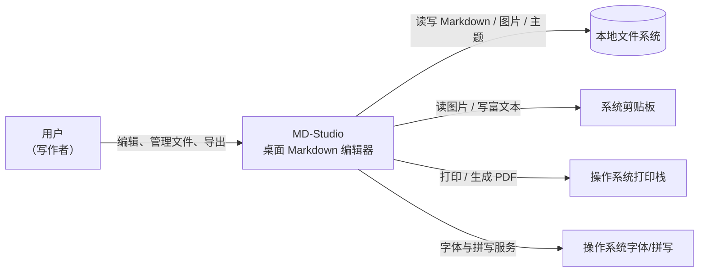

# C1: Context 视图

> C4 Level 1 | 对应 RFC-001（评审已通过，见 RFC-001 §0） | Updated: 2026-10-28 | 状态：有效（v0.2 已交付；边界、参与者与约束经复核未变）

## 1. 总览图

## 2. 参与者与外部系统

| 角色/系统 | 与本系统的关系 |
|---|---|
| 用户（写作者） | 唯一直接使用者；单机、离线，不需要账号 |
| 本地文件系统 | 文档、图片资产、主题、草稿与设置的存储介质 |
| 系统剪贴板 | 图片/富文本粘贴入口（REQ-006） |
| 操作系统打印栈 | PDF 输出承载（REQ-014） |
| 操作系统字体/拼写 | 中文渲染回退与拼写检查（REQ-008） |

## 3. 关键约束（不变量）

1. **本地优先**：无账号、无云依赖；断网可用。
2. **自有实现**：不复制参考产品（Typora 1.14.10）的代码、样式或资源；仅对齐交互能力（依据 `docs/analysis/typora/findings.md`）。
3. **许可边界**：不实现任何授权/激活/DRM 机制，也不研究其绕过方式（findings §6）。
4. **平台**：Windows 优先发布；macOS/Linux 为后续目标（ADR-001）。
5. **语言**：UI 以简体中文为首发语言，代码与标识符用英文；文案与结构保留 i18n 扩展点。
6. **隐私**：v1 不做遥测与远程上报。

## 4. 变更日志

- 2026-10-27 初版：定义系统边界、参与者与约束（对应 RFC-001 Draft）。
- 2026-10-28 状态行对齐实现进度：v0.2 已交付，未新增外部系统，六条约束仍然成立。
