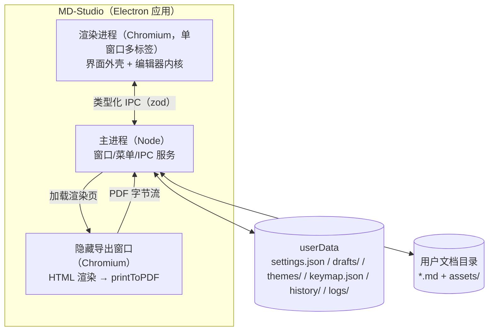

# C2: Container 视图

> C4 Level 2 | 对应 RFC-001 §3/§4.1 | Updated: 2026-10-28 | 状态：已实现（v0.2）；路径与行号已按 `md-studio/` 当前代码回填。行号会随代码演进漂移，**以符号名为准**，行号仅作定位辅助。

## 1. 总览图

## 2. 容器详述

### 2.1 主进程（Electron main，`src/main/`）

- **职责**：应用生命周期；窗口创建与状态恢复；原生菜单与快捷键转发；全部文件系统操作（原子写入、mtime 比对）；目录监听（`chokidar`）；设置/草稿/历史/键位存储；主题目录扫描；搜索与正文缓存；导出编排；日志。
- **技术**：TypeScript + Electron；无 UI 渲染职责。运行期依赖仅 `chokidar` 与 `zod`。
- **落点**：

| 能力 | 文件:行 | 符号 |
|---|---|---|
| 启动与生命周期 | `src/main/index.ts:158` | `app.whenReady().then(bootstrap)` |
| 窗口创建与关闭确认 | `src/main/window.ts:96` | `createWindow` |
| IPC 注册 | `src/main/ipc.ts:115` | `registerIpc` |
| 文件读写（原子写） | `src/main/fs-service.ts:49` | `writeTextAtomic` |
| 冲突对话框（重载/另存/覆盖） | `src/main/fs-service.ts:136` | `askConflictChoice` |
| 工作区操作与监听 | `src/main/workspace.ts:165` | `WorkspaceWatcher` |
| 图片资产落盘 | `src/main/workspace.ts:129` | `saveAsset` |
| 设置存储 | `src/main/settings.ts:7` | `SettingsStore` |
| 主题扫描与读取 | `src/main/themes.ts:9` | `ThemeStore` |
| 键位覆盖存储 | `src/main/keymap-store.ts:17` | `KeymapStore` |
| 草稿存储 | `src/main/drafts.ts:21` | `DraftStore` |
| 文件历史快照 | `src/main/history.ts:18` | `HistoryStore` |
| 搜索（目录/内容，有界并发） | `src/main/search.ts:175` | `searchDirectory` |
| 正文缓存 | `src/main/content-cache.ts:32` | `setTrustedRoot` |
| 导出编排 | `src/main/exporters.ts:181` | `exportPdf`（另见 `:23` `exportHtml`、`:97` `exportImage`） |
| Pandoc 互操作 | `src/main/pandoc.ts:43` | `detectPandoc` |
| 原生菜单 | `src/main/menu.ts:15` | `buildApplicationMenu` |
| 日志 | `src/main/logger.ts:7` | `initLogger` |

### 2.2 渲染进程（单窗口，多标签）

- **职责**：界面外壳（标题栏/侧栏/状态栏）、文件树与搜索视图、大纲与统计、编辑器内核（CodeMirror 6 + 实时预览装饰 + 命令注册表）、多标签会话池、导出渲染、i18n。
- **技术**：TypeScript + CodeMirror 6 + highlight.js + markdown-it + KaTeX + Mermaid；不直接访问 Node/文件系统。
- **落点**：`src/renderer/app.ts`（外壳装配与命令接线）、`src/renderer/doc-manager.ts:43`（文档生命周期与自动保存）、`src/renderer/session.ts:54`（标签会话池）、`src/renderer/editor/`（`setup.ts:129` 编辑器装配、`live-preview.ts:129` 装饰、`widgets.ts` 块级组件、`commands.ts:81` 编辑命令、`modes.ts:5` 视图模式、`languages.ts:136` 语言表）、`src/renderer/shell/`（`file-tree.ts:34`、`search-view.ts:32`、`outline-view.ts:15`、`tab-bar.ts:40`、`virtual-list.ts:48`、`dialogs.ts:37`、`settings-view.ts:18`）、`src/renderer/export/`（`render-html.ts:220`、`highlight.ts`、`katex-fonts.ts:87`）、`src/renderer/i18n.ts:25`。

> 与 v0.1 设计的偏差：原设计的「每窗口一文档」已由 RFC-002 REQ-032 改为**单窗口多标签**（`SessionPool`），因此渲染进程数不再随文档数增长；拖出成窗明确不做（backlog B5-1）。

### 2.3 隐藏导出窗口

- **职责**：加载与编辑视图同源的渲染页（HTML/主题 CSS 一致），执行 `webContents.printToPDF`；生命周期短暂、不显示、不参与交互。
- **落点**：`src/main/exporters.ts:142`（`printDocument`）与 `:181`（`exportPdf`）；渲染侧 HTML 由 `src/renderer/export/render-html.ts:220` 生成。
- **约束**：与可见窗口共享同一套主题变量（`--md-*`）与排版 CSS，保证导出"所见即所得"。

### 2.4 本地存储

| 位置 | 内容 | 落点 |
|---|---|---|
| `userData/settings.json` | 窗口布局、最近文件、模式/主题/语言、自动保存参数、标签页与导出选项 | `src/main/settings.ts:14` |
| `userData/drafts/` | 崩溃恢复草稿（按文档 id 命名） | `src/main/drafts.ts:27` |
| `userData/themes/*.css` | 用户主题（头部注释携带元数据） | `src/main/themes.ts:15` |
| `userData/keymap.json` | 用户键位覆盖 | `src/main/keymap-store.ts:27` |
| `userData/history/<hash>/` | 文档历史快照（上限 50 条） | `src/main/history.ts:22` |
| `userData/logs/` | 主进程日志 | `src/main/logger.ts:8` |
| 文档目录 `assets/` | 粘贴/拖拽图片资产 | `src/main/workspace.ts:129` |

## 3. 进程间协议

- 通道名集中定义在 `src/shared/channels.ts:8`（`file:*`、`workspace:*`、`settings:*`、`themes:*`、`draft:*`、`search:*`、`export:*`、`app:*`），参数 schema 在 `src/shared/ipc.ts:7` 起（zod），渲染层可见的 API 类型为 `src/shared/api.ts:53` 的 `MdStudioApi`。
- 主进程侧在 `src/main/ipc.ts:115` 统一注册；预加载在 `src/preload/index.ts:103` 以 `contextBridge.exposeInMainWorld('mdstudio', api)` 暴露，只做转发。
- 事件方向：主进程 → 渲染进程为单向事件（如 `themes:changed`）；渲染进程 → 主进程为请求/响应。渲染层只依赖共享类型（ADR-001 Decision 3/4）。

## 4. 部署与运行时

- 开发：`npm --prefix md-studio run dev`（electron-vite，主/预加载/渲染热更新）。包管理器决策：npm（B2-2）。
- 测试：Vitest 单元（`tests/`）+ Playwright-Electron 端到端（`e2e/app.spec.ts`、`e2e/ime.spec.ts`）。
- 打包：electron-builder，配置在 `md-studio/package.json` 的 `build` 字段。Windows → NSIS（x64）；macOS → dmg + zip（x64/arm64）；Linux → AppImage + deb。产物落在 `md-studio/release/`，脚本 `dist:win` / `dist:mac` / `dist:linux`。三端由 `.github/workflows/package.yml` 的系统矩阵分别构建（Electron 无法在单一系统上交叉打包），打 `v*` tag 时自动汇总发布 Release。本机实测：Windows 安装包构建成功，打包后的应用可启动（日志 `[md-studio] ready` + 渲染层就绪）。
- 运行时依赖：Node ≥ 22；无外部服务依赖（离线可用），Pandoc 为可选外部工具。

## 5. 变更日志

- 2026-10-27 初版：确立主进程/渲染进程/隐藏导出窗口/本地存储四个容器与 IPC 协议分组（对应 RFC-001 Draft）。
- 2026-10-28 状态行对齐实现进度：四个容器均已落地（主进程服务为平铺文件而非 `services/` 子目录，IPC 为单文件 `src/shared/ipc.ts`）；路径未回填，见状态行。
- 2026-10-28 回填实现路径：按 `src/main/`、`src/renderer/`、`src/shared/` 真实文件与符号补齐 file:line；补入 `history/` 存储项；修正两处与实现不符的描述——渲染进程为**单窗口多标签**（不再是每窗口一文档），打包流程**尚未实现**（原写 electron-builder → NSIS）。
- 2026-10-28 打包落地：electron-builder 与三系统 CI 矩阵接入（Windows 已在本机实测构建并启动），§4 同步更新。
