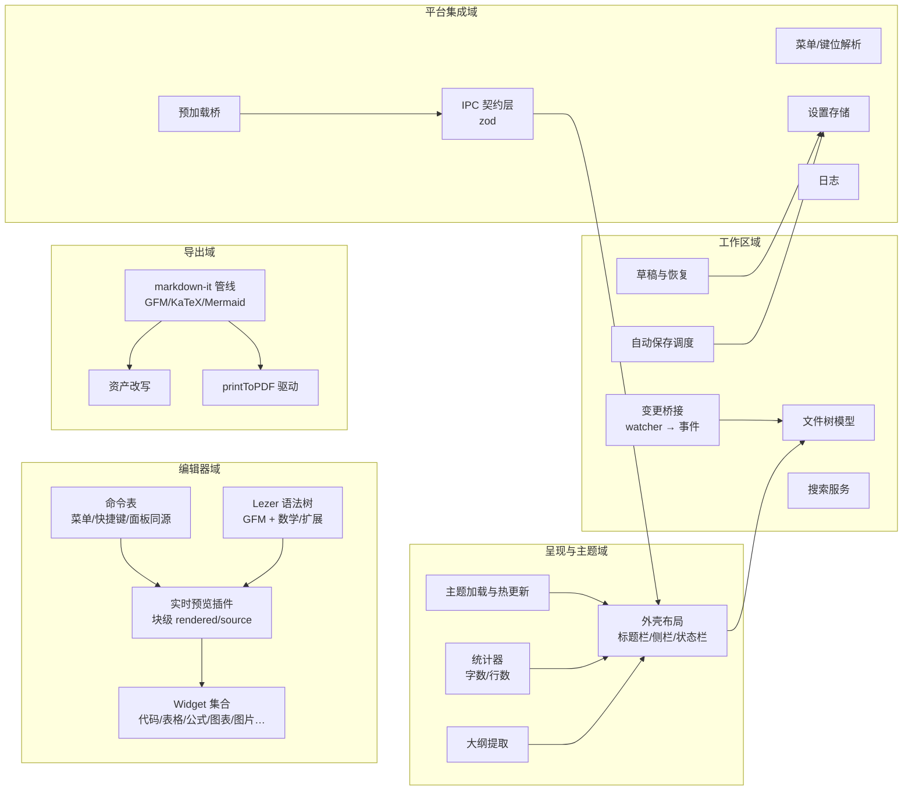

# C3: Component 视图

> C4 Level 3 | 对应 RFC-001 §4 | Updated: 2026-10-28 | 状态：已实现（v0.2）；路径与行号已按 `md-studio/` 当前代码回填。行号会随代码演进漂移，**以符号名为准**，行号仅作定位辅助。

## 1. 总览图

## 2. 组件详述与追溯

### 2.1 编辑器域（RFC-001 §4.3，REQ-001~008）

- **语法树**：没有独立 `parser.ts`。Markdown 解析直接用 `@lezer/markdown`（GFM + 数学/扩展语法），在 `src/renderer/editor/setup.ts:129`（`createEditor`）装配；扩展语法规则在 `src/shared/extended-syntax.ts`，语言表在 `src/renderer/editor/languages.ts:136`（`CODE_LANGUAGES`）。
- **实时预览插件**：`src/renderer/editor/live-preview.ts:129`（`computeDecorations`）——遍历 `syntaxTree`（`:204`/`:212`）做块级投影：活动块=源码，其余=渲染；装饰只做投影、不改文档偏移。块级组件扩展在 `:662`（`blockWidgetsExtension`）。
- **Widget 集合**：`src/renderer/editor/widgets.ts` —— `HrWidget:17`、`FenceChipWidget:33`、`TaskWidget:54`、`EmojiWidget:80`、`FootnoteRefWidget:102`、`FrontMatterWidget:128`、`HtmlBlockWidget:174`、`ImageWidget:206`、`TableWidget:253`、`MathWidget:287`、`MermaidWidget:359`；渲染辅助 `renderMathHtml:312`、`renderMermaidToSvg:418`、`invalidateMermaidCache:424`。
- **命令表**：编辑命令实现于 `src/renderer/editor/commands.ts:81` 起（行内样式 `:81`、表格 `:256`/`:369`），命令元数据集中在 `src/shared/commands.ts:21`（`COMMANDS`），菜单、快捷键、命令面板共用同一张表（REQ-015 前置）。
- **视图模式**：`src/renderer/editor/modes.ts:5`（`focusModeExtension`）、`:51`（`typewriterExtension`）；模式状态经设置持久化（REQ-007）。
- **输入法**：组合期装饰映射由 `live-preview.ts` 与 `src/renderer/editor/setup.ts` 共同保证，回归用例见 `tests/editor/ime.test.ts`、`e2e/ime.spec.ts`。

### 2.2 工作区域（RFC-001 §4.4，REQ-009~011）

- **文件树模型**：`src/renderer/shell/file-tree.ts:34`（`FileTree`）——目录快照 + 增量合并；节点操作走 `workspace:*` IPC（`src/main/workspace.ts:57` `createEntry`、`:71` `renameEntry`、`:85` `deleteEntry`、`:93` `moveEntry`）。
- **变更桥接**：`src/main/workspace.ts:165`（`WorkspaceWatcher`，chokidar）→ 渲染层事件；冲突处理在 `src/main/fs-service.ts:136`（`askConflictChoice`），三选一（重载/另存/覆盖）。
- **自动保存调度**：**在渲染层**，按标签各自持有计时器（`src/renderer/doc-manager.ts:390` 起，参数 `settings.autosave.{enabled,delayMs}`）；不是独立的主进程服务。
- **草稿与恢复**：`src/main/drafts.ts:21`（`DraftStore`）+ `src/shared/draft-id.ts`；启动时扫描未正常关闭的会话并提供恢复入口（`tests/workspace/recovery.test.ts`）。
- **搜索服务**：`src/main/search.ts:175`（`searchDirectory`，文件名 + 内容子串，有界并发 `:54`/`:57`/`:64`），正文缓存 `src/main/content-cache.ts:32`（`setTrustedRoot`，监听根跳过逐文件 `stat`），视图 `src/renderer/shell/search-view.ts:32`（虚拟滚动）。

### 2.3 呈现与主题域（RFC-001 §4.2/§4.5，REQ-012/013）

- **外壳布局**：`src/renderer/app.ts`（装配与命令接线）、`src/renderer/shell/`（`tab-bar.ts:40`、`dialogs.ts:37`、`settings-view.ts:18`、`context-menu.ts:115`、`history-view.ts:29`）；布局状态进 `settings.json`。
- **大纲与统计**：**不复用语法树**——大纲是对标题行的正则扫描（`src/shared/outline.ts:33` `extractOutline`），统计是字符/词/行计数（`src/shared/text-stats.ts:12` `countText`）；视图侧 `src/renderer/shell/outline-view.ts:15`。这是与 v0.1 设计描述（"复用解析器语法树"）的偏差，代价是极低、收益是可在纯文本上工作。
- **主题**：`src/main/themes.ts:9`（扫描 `userData/themes/*.css` 并热加载）、`src/shared/theme-meta.ts:18`（`parseThemeMeta`，头部注释元数据，体积上限 `:16`）、内置主题 `src/renderer/themes/built-in/{light,dark}.css`（`:root` 定义 `--md-*` 变量，`light.css:2`）；应用方式为 `document.documentElement.dataset.theme`（`src/renderer/app.ts:367`）+ 注入样式表（`:112`/`:114`），失败回退内置。

### 2.4 导出域（RFC-001 §4.6，REQ-014）

- **渲染管线**：`src/renderer/export/render-html.ts:123`（`renderDocumentBody`）/`:220`（`renderDocumentHtml`）——markdown-it + GFM/脚注/定义列表（`md-extended.ts`）；代码高亮用 **highlight.js**（`src/renderer/export/highlight.ts`，非设计稿写的 Shiki）；KaTeX 字体可选内联（`katex-fonts.ts:87` `inlineKatexFonts`，三档 `off|common|all`）。
- **资产改写**：`src/renderer/export/render-html.ts:80` 的自定义 image 规则（相对化/内联）；HTML→Markdown 反向导入在 `src/renderer/export/html-to-md.ts`，净化在 `html-sanitize.ts`。
- **PDF 驱动**：`src/main/exporters.ts:181`（`exportPdf`）→ `printDocument:142`；页面与页边距选项在 `src/shared/pdf-options.ts:14`（`DEFAULT_PDF_MARGINS`）。HTML 静态导出在 `exporters.ts:23`，图片导出在 `:97`（`exportImage`）。
- **Pandoc 互操作**：`src/main/pandoc.ts:43`（`detectPandoc`）、`:88`（`pandocExport`）、`:133`（`pandocImport`），参数构造在 `src/shared/pandoc-args.ts`。

### 2.5 平台集成域（RFC-001 §4.1/§4.7，REQ-015）

- **IPC 契约层**：`src/shared/ipc.ts:7` 起（zod schema 与类型同源）、通道名 `src/shared/channels.ts:8`、渲染层 API `src/shared/api.ts:53`；主进程注册 `src/main/ipc.ts:115`（`registerIpc`）。
- **预加载桥**：`src/preload/index.ts:103`（`contextBridge.exposeInMainWorld`），仅转发 + 参数校验。
- **菜单/键位**：`src/main/menu.ts:15`（`buildApplicationMenu`）、`src/shared/keymap.ts:229`/`:244`（`parseUserKeymap`/`resolveKeymap`）、用户覆盖 `src/main/keymap-store.ts:17`、默认表 `src/shared/keymap/default.json`。
- **设置存储/日志**：`src/main/settings.ts:7`（`SettingsStore`，去抖 + 原子写）、`src/shared/settings.ts:87`/`:165`（默认值/sanitize）、`src/main/logger.ts:7`（`initLogger`）。

## 3. 数据流

1. **保存**：编辑器事务 → 命令 `file.save` → `file:save` IPC → `src/main/fs-service.ts:49`（`writeTextAtomic`，含 mtime 比对）→ 标题栏清除未保存标记。
2. **外部变更**：`WorkspaceWatcher`（`src/main/workspace.ts:165`）→ 渲染层提示 → `src/main/fs-service.ts:136` 的三选一对话框（重载/另存/覆盖）。
3. **导出 PDF**：`export:pdf` 请求 → `renderer/export/render-html.ts` 产出 HTML → 隐藏窗口加载 → `printToPDF` → 原子落盘 → 返回路径（`src/main/exporters.ts:181`）。
4. **主题热加载**：主题目录监听（`src/main/themes.ts:9`）→ 解析元数据 → `themes:changed` 事件 → 渲染层替换样式表（`src/renderer/app.ts:112`/`:114`，失败回退内置）。

## 4. 部署与运行时

见 C2 §4：electron-vite 开发、electron-builder 三端打包（Windows 已在本机实测构建并启动；macOS/Linux 由 CI 矩阵构建）、Vitest + Playwright-Electron 验证、无外部服务（Pandoc 可选）。

## 5. 追溯矩阵

| 域 | RFC/ADR | REQ | 测试文件（已实现） |
|---|---|---|---|
| 编辑器域 | RFC-001 §4.3 / ADR-002 | REQ-001~008 | `tests/editor/{live-preview,code-block,table,table-toolbar,math,mermaid,image,modes,ime,outline,front-matter,extended-syntax}.test.ts` |
| 工作区域 | RFC-001 §4.4 | REQ-009~011 | `tests/workspace/{file-tree,watch,recovery,search,history}.test.ts` |
| 呈现与主题域 | RFC-001 §4.2/§4.5 | REQ-012/013 | `tests/editor/outline.test.ts`、`tests/theme/theme.test.ts`、`tests/text-stats.test.ts`、`tests/platform/{virtual-list,tabs,i18n,settings,view-controls}.test.ts`、`tests/renderer/tab-reorder.test.ts` |
| 导出域 | RFC-001 §4.6 | REQ-014 | `tests/export/{export,pdf,extended-export,inline-fonts,pandoc,sanitize,clipboard}.test.ts` |
| 平台集成域 | RFC-001 §4.1/§4.7 / ADR-001 | REQ-015 | `tests/platform/keymap.test.ts`、`tests/shared/{diff,toc}.test.ts` |

端到端：`e2e/app.spec.ts`（14 用例）+ `e2e/ime.spec.ts`（4 自动 + 2 人工，见 `docs/qa/2026-10-28-md-studio-ime-regression.md`）。

## 6. 变更日志

- 2026-10-27 初版：设计态组件分解与追溯矩阵（对应 RFC-001 Draft；实现后回填 file:line 与测试实数）。
- 2026-10-28 状态行对齐实现进度：五个域的组件均已落地；`parser.ts`、`widgets/`、`commands/`、`modes/` 等计划路径实际为同名平铺文件，导出域在 `src/renderer/export/`，file:line 仍未回填。
- 2026-10-28 回填实现路径：按真实文件与符号补齐 file:line；追溯矩阵改为实际存在的测试文件。修正三处与实现不符的描述——**无独立 `parser.ts`**（解析在 `editor/setup.ts` 装配）、**大纲/统计不复用语法树**（正则实现，`shared/outline.ts`、`shared/text-stats.ts`）、**代码高亮用 highlight.js 而非 Shiki**。
