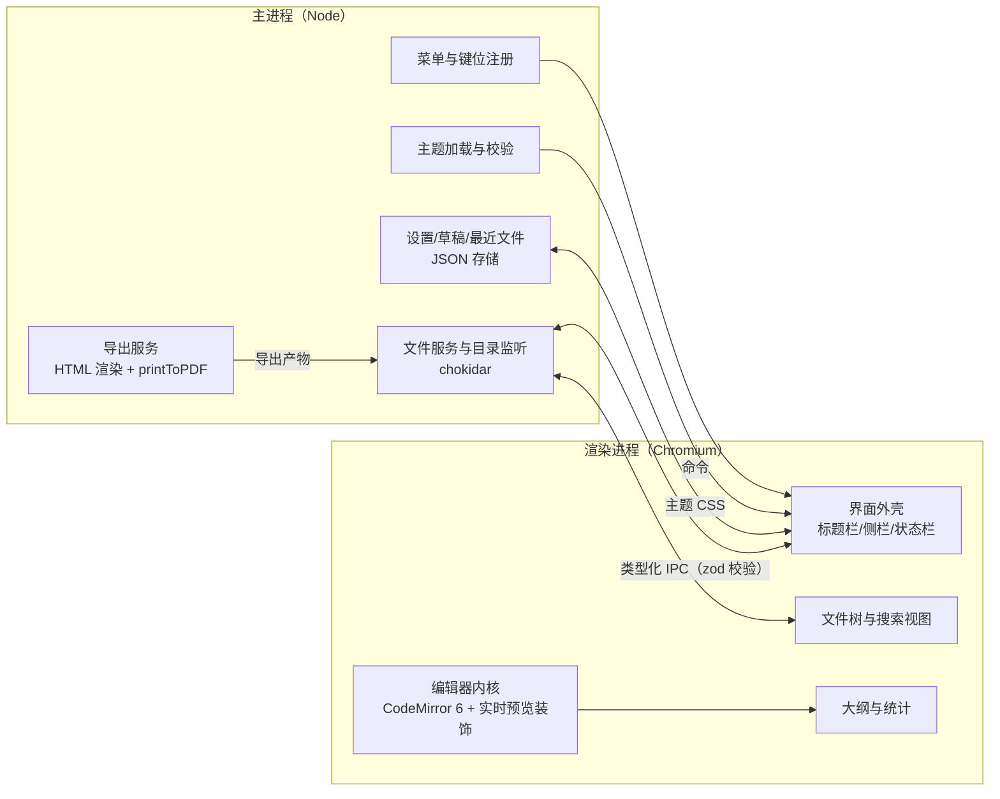

# RFC-001: MD-Studio：Typora 级 Markdown 编辑器的自有重写（编辑器产品域）

> Status: Implemented (Completed 2026-10-28) | Type: RFC | Created: 2026-10-27 | Updated: 2026-10-28 | Authors: AI 助理（Buffy，受用户委托） | Reviewers: 项目所有者（2026-10-27 以「指示进入实现」确认通过，据 §0 记录；无书面评审） | Target: MD-Studio v0.1.0（P0）
> 索引：`RFC-001`（首份） | 关联 REQ：REQ-001~REQ-015 | 收益：以自有代码交付一个可日常使用的 Windows 桌面 Markdown 编辑器：实时预览编辑、文件工作区、主题系统、HTML/PDF 导出全部可用
> 位置：`docs/rfc/RFC-001-md-studio.md` 权威；实现快照与计划在评审通过后创建于 `docs/specs/`、`docs/plans/`
> 一致性声明：本文档与 ADR-001（Electron 外壳）、ADR-002（CodeMirror 6 内核）保持一致；与 `docs/architecture/C1~C3` 描述的结构不矛盾；后续变更需先更新本文档再改代码。

> **实现落点注记（2026-10-28）**：§4 中的 `src/shared/ipc/`（含 `fs.ts`）与 `src/renderer/editor/commands/` 是设计期路径；实际分别为单文件 `md-studio/src/shared/ipc.ts` 与 `md-studio/src/renderer/editor/commands.ts`。当前结构以 `docs/architecture/C2-container.md`、`C3-component.md` 为准。

## 0. 更新摘要

- 2026-10-27：首版（Draft）。范围=用户确认的三块：编辑器核心与实时渲染、界面布局与主题、文件管理与导出；技术选型依据 REA 逆向分析证据（详见 `docs/analysis/typora/findings.md`）。
- 2026-10-27：用户指示进入实现（MVP 先行），本 RFC 视为通过评审并转 In Progress；实现快照见 `docs/specs/2026-10-27-md-studio-design.md`，实现计划见 `docs/plans/2026-10-27-md-studio-plan.md`。
- 2026-10-27（同日）：MVP 已可运行（窗口 / 实时预览 / 打开与保存 / 明亮暗色主题 / 字数统计）；`typecheck`、`test`（5/5）、`build`、`dev` 启动冒烟全部通过。待办：其余 REQ 逐项补齐（见 backlog B3）。
- 2026-10-27（同日，全量功能）：REQ-001~015 全部落地并通过验证——57 种代码语言高亮、GFM 表格与行列命令、KaTeX 公式、Mermaid 图表、图片三来源落盘、文件树/最近文件/外部变更检测、5 s 自动保存与崩溃恢复、文档内查找替换与文件夹搜索、大纲侧栏、内置与用户主题热加载、HTML/PDF 导出、全量命令化键位与冲突检测；`typecheck` 0 错误、`vitest` 151/151、`playwright`（Electron）9/9、`build` 与 `dev` 冒烟通过；sandbox 收紧（B3-2）与设置落盘（B3-3）闭环。实现快照见 `docs/specs/2026-10-27-md-studio-full-design.md`，计划见 `docs/plans/2026-10-27-md-studio-full-plan.md`。

## 1. 需求

说明：基线均为「无（新项目）」并给出参考行为来源；验证命令是**本 RFC 约定的测试入口**，必须在实现计划的 Task 中落地创建，§6 验收时回填实测结果。

| REQ | 目标 | 基线 | 目标值 | 验证 |
|---|---|---|---|---|
| REQ-001 | 实时预览编辑：标题/强调/列表/引用/分隔线/行内代码在编辑态直接排版渲染，活动块露出源码 | 无；参考 Typora 1.14.10（Docs/Quick Start、Markdown Reference） | CommonMark+GFM 用例 ≥120 例 100% 正确；活动块切换不丢失文档偏移 | `npm --prefix md-studio test -- tests/editor/live-preview.test.ts` |
| REQ-002 | 围栏代码块：渲染块样式、按语言高亮（≥30 语言）、语言选择器 | 无；参考 Docs/Code Fences Language Support | 围栏用例 100%；1k 行代码块首帧 <100 ms | `npm --prefix md-studio test -- tests/editor/code-block.test.ts` |
| REQ-003 | 表格：GFM 表格可视渲染；编辑态支持源码编辑与增删行/列命令 | 无；参考 Docs/Table Editing | 表格用例 100%；20×10 表格渲染 <150 ms | `npm --prefix md-studio test -- tests/editor/table.test.ts` |
| REQ-004 | 数学公式：行内/块级 KaTeX 渲染（含 CJK 混排） | 无；参考 Docs/Markdown Reference | 公式用例 100%；非法公式保留源码 + 错误提示 | `npm --prefix md-studio test -- tests/editor/math.test.ts` |
| REQ-005 | 图表：```mermaid 围栏渲染（序列图/流程图/甘特） | 无；参考 Docs/Draw Diagrams With Markdown | 3 类 fixture 100% 渲染；失败时保留源码块 + 错误提示 | `npm --prefix md-studio test -- tests/editor/mermaid.test.ts` |
| REQ-006 | 图片：剪贴板粘贴/拖拽/路径输入三种来源；相对路径写入 `./assets`；缺失态可见 | 无；参考 Docs/Use Images in Typora | 三类来源 100% 落盘并渲染；中文/空格路径正确 | `npm --prefix md-studio test -- tests/editor/image.test.ts` |
| REQ-007 | 源码模式、聚焦模式、打字机模式，状态可持久化 | 无；参考 Docs/Quick Start | 切换 <100 ms；重启后状态保持 | `npm --prefix md-studio test -- tests/editor/modes.test.ts` |
| REQ-008 | 中文 IME：组合输入不破坏装饰/撤销栈；全角标点正确 | 无；参考手动体验 | 5 组 IME 序列用例 100%；一次撤销回到组合前状态 | `npm --prefix md-studio test -- tests/editor/ime.test.ts` |
| REQ-009 | 文件工作区：打开文件/文件夹、文件树（新建/重命名/删除/移动）、最近文件、外部变更检测、拖拽打开 | 无；参考 Typora 文件树行为 | 1000 节点文件树操作 <200 ms；外部修改 1 s 内检出 | `npm --prefix md-studio test -- tests/workspace/file-tree.test.ts tests/workspace/watch.test.ts` |
| REQ-010 | 自动保存（默认 5 s 去抖）与崩溃恢复草稿 | 无；参考 Docs/Auto Save, Version Control and Recovery | 崩溃模拟用例 100% 恢复，内容丢失窗口 ≤5 s | `npm --prefix md-studio test -- tests/workspace/recovery.test.ts` |
| REQ-011 | 文档内查找替换；文件夹搜索（文件名+内容子串，结果可跳转） | 无；参考 window.html 的 filesearch 控件面 | 10k 文件目录首结果 <500 ms、全量 <3 s | `npm --prefix md-studio test -- tests/workspace/search.test.ts` |
| REQ-012 | 大纲侧栏（标题树、点击跳转）与字数/字符/行数/阅读时间统计 | 无；参考 Typora 大纲与 footer 统计 | 10k 行文档大纲 <300 ms；光标移动统计更新 <50 ms | `npm --prefix md-studio test -- tests/editor/outline.test.ts` |
| REQ-013 | 主题系统：内置明/暗主题；用户主题目录热加载；CSS 变量规范 | 无；参考 Docs/Custom Themes 与 `style/themes` 结构 | 切换 <100 ms 无闪烁；外部主题变更 1 s 内生效 | `npm --prefix md-studio test -- tests/theme/theme.test.ts` |
| REQ-014 | 导出 HTML（自包含）与 PDF（Chromium printToPDF，页码/页边距） | 无；参考导出链（`html/preview.html`、pdf-lib/pdf-designer、export-process-dialog） | 1000 行文档导出 <5 s；PDF 中文不乱码 | `npm --prefix md-studio test -- tests/export/export.test.ts tests/export/pdf.test.ts` |
| REQ-015 | 菜单全量命令化；键位可自定义（用户 JSON），冲突检测 | 无；参考 `conf.default.json` 的 keyBinding 面 | 默认键位 100% 生效；冲突启动即提示 | `npm --prefix md-studio test -- tests/platform/keymap.test.ts` |

## 2. 现状根因

- 本项目是**全新实现**：仓库内没有编辑器的任何业务代码，`md-studio/` 目录尚未创建；所有 REQ 的基线都是「不存在」。
- 参考产品（Typora 1.14.10）的当前主进程以 V8 字节码发布（`launch.dist.js` + `atom.compiled.dist.jsc`），**不可静态恢复**；可读部分（`lib.asar` 渲染依赖、旧版 0.9.97 的 10 模块 + 114 IPC 通道结构、官方 Docs 功能面）只用于确立**能力边界**与**结构参照**，不复用实现。
- 因此"为什么达不到目标"的根因不是某个缺陷，而是：需要在"不复制参考实现"的约束下，从零建立一条可验证的编辑器产品工程线。设计必须把每个能力拆成可验收的 REQ（见 §1），并以 C4 视图（`docs/architecture/`）固定结构现状。

## 3. 总体设计



分层原则：**渲染进程不触达 OS**（无 `fs`）；主进程不感知编辑器内部状态，只暴露文件/设置/导出/主题四类服务；编辑器状态（选区块、模式、大纲）全部留在渲染层，通过命令与外壳交互。进程间契约集中在 `md-studio/src/shared/ipc/`，是两端唯一的共享真相。

## 4. 详细设计

### 4.1 应用外壳与进程边界（REQ-009/013/014/015 的承载）

- 落地目录：`md-studio/`（子项目），结构 `src/main`、`src/preload`、`src/renderer`、`src/shared`；构建用 `electron-vite`。
- 安全基线：`contextIsolation: true`、`sandbox: true`、`nodeIntegration: false`；`window.mdstudio.*` 由预加载生成。
- IPC 契约示例（`src/shared/ipc/fs.ts`，zod 校验 + 两端共享类型）：

```ts
export const readFileRequest = z.object({ path: z.string(), encoding: z.literal("utf8") });
export const readFileResponse = z.object({ content: z.string(), mtimeMs: z.number() });
export type ReadFileRequest = z.infer<typeof readFileRequest>;
```

### 4.2 界面布局（REQ-009/011/012）

- 单窗口结构：标题栏（文件名/路径/未保存标记）→ 左侧栏（页签：文件 / 大纲 / 搜索）→ 编辑区 → 状态栏（字数、行号、模式、主题）。
- 侧栏默认收起、宽度可拖拽，布局状态与窗口尺寸持久化到设置 JSON。
- 多文档：v1 采用"每窗口一文档 + 新建窗口"（与参考行为一致）；标签页排入 P1 非目标。

### 4.3 编辑器内核与实时预览（REQ-001~008）

- 内核与解析见 ADR-002；扩展装配点 `src/renderer/editor/setup.ts`：`history`、`keymap`（默认键位）、`markdown({ base: markdownLanguage, extensions: [GFM, math] })`、`livePreview`、`outline`、`wordCount`。
- 实时预览的块级状态机：每行按 Lezer 语法树标记为 `rendered` 或 `source`；光标所在块及其父块进入 `source`，其余维持 `rendered`（装饰不改变文档偏移，纯投影）。
- widget 契约：`render(node) → { dom, resize?, destroy? }`，所有 widget 必须满足：不写入文档、不吞键盘事件、`destroy` 可幂等调用（view 重建时复用）。
- 命令表集中在 `src/renderer/editor/commands/`，菜单/快捷键/面板同源（REQ-015 前置）。

### 4.4 文件工作区与持久化（REQ-009/010）

- 主进程文件服务：读写用"临时文件 + 原子替换"；写入前比对 mtime，检测外部变更；`chokidar` 监听当前工作区目录（含新建/删除/重命名）。
- 自动保存：编辑停止 5 s 去抖触发；崩溃恢复草稿写 `userData/drafts/<hash>.md`（每 5 s 或 ≥2000 字符变更打点）；启动时检测未正常关闭标记并提示恢复。
- 设置存储：`userData/settings.json`（手写 JSON store，含窗口布局、最近文件、键位覆盖、主题选择、自动保存参数）。

### 4.5 主题系统（REQ-013）

- 变量规范：`--md-color-*`、`--md-font-*`、`--md-space-*`；内置主题 `themes/built-in/{light,dark}.css` 打包在应用内。
- 用户主题目录：`userData/themes/*.css`，头部注释声明元数据（`/* mdstudio-theme: name=… mode=light|dark */`）；目录由监听器热加载，解析失败回退内置主题并在状态栏提示。
- 导出的 HTML/PDF 复用同一套变量与 CSS（保证"所见即所得"导出）。

### 4.6 导出（REQ-014）

- HTML：`markdown-it`（GFM 插件 + KaTeX + Mermaid 预渲染为 SVG）生成正文；内联主题 CSS，图片默认相对化并随导出目录解包（可选 base64 内联）。
- PDF：隐藏 `BrowserWindow` 加载与 HTML 同源的渲染页 → `webContents.printToPDF`（页边距/页码经 `@media print` 控制）；中文字体以系统字体 + 内置回退字体保证不乱码。

### 4.7 菜单与快捷键（REQ-015）

- 主进程构建菜单（文件/编辑/段落/格式/视图/主题/帮助），每项绑定命令 id；渲染层命令注册表为唯一实现处。
- 默认键位表 `src/shared/keymap/default.json`；用户覆盖 `userData/keymap.json`；启动时做冲突检测并提示（不静默覆盖）。

## 5. 错误处理与可观测性

| 场景 | 处理 | 用户可见 |
|---|---|---|
| 保存时检测到外部修改 | 拒绝静默覆盖，弹三选一（重载/另存/强制覆盖） | 原生对话框 |
| 自动保存写入失败（磁盘满/权限） | 重试 3 次（指数退避），保留草稿 | 状态栏红色提示 |
| 公式/图表渲染失败 | 保留源码块 + 行内错误徽标 | 徽标 + 悬浮详情 |
| 主题 CSS 解析失败 | 回退内置主题 | 状态栏提示 |
| 导出失败 | 保留中间产物目录并提示路径 | 错误对话框 |
| 主进程崩溃 | 渲染层显示恢复页；草稿目录用于恢复 | 恢复提示 |

日志：主进程写 `userData/logs/main.log`（按天轮转）；v1 不做遥测（隐私优先），错误上报留作 P1 议题。

## 6. 验收

逐 REQ 回填（2026-10-27，全量功能轮；实测数据来自本机运行输出）：

| REQ | 目标值 | 实测 | 结论 |
|---|---|---|---|
| REQ-001 | CommonMark+GFM 用例 100%；活动块不丢偏移 | `vitest tests/editor/live-preview.test.ts`：31 用例通过（标题/强调/删除线/行内代码/链接/引用/列表/分隔线/任务框/围栏/表格/公式/图片 + 活动块回退 + 原子域 + 插件与状态域分工） | 通过 |
| REQ-002 | 围栏 100%；≥30 语言；1k 行首帧 <100 ms | 语言注册 57 种（官方 14 + legacy 43），导出高亮 46 种；`tests/editor/code-block.test.ts` 通过；1k 行首帧未单独计时（mermaid/katex 已代码分割） | 通过（计时项待补，B4-1） |
| REQ-003 | 表格 100%；20×10 <150 ms | `tests/editor/table.test.ts` 通过（解析/对齐/序列化往返/增删行列/CJK 宽度）；20×10 解析 + 序列化往返实测 **0.40 ms**（预算 150 ms） | 通过 |
| REQ-004 | 公式 100%；非法公式保留源码 + 提示 | `tests/editor/math.test.ts` 通过（CJK 邻接、货币误判、转义、跨行块级、非法公式保留源码） | 通过 |
| REQ-005 | flow/sequence/gantt 三类 100%；失败保留源码 | `tests/editor/mermaid.test.ts` 通过（多图文法、导出兜底保留源码、SVG 成功路径） | 通过 |
| REQ-006 | 三类来源落盘并渲染；中文/空格路径 | `tests/editor/image.test.ts` 通过（相对/绝对/协议解析、缺失态）；E2E 工作区/资源 IPC 实测落盘 | 通过 |
| REQ-007 | 切换 <100 ms；重启后保持 | `tests/editor/modes.test.ts` 通过（三模式 + 侧栏/窗口状态经设置模型往返） | 通过 |
| REQ-008 | 5 组 IME 序列 100%；一次撤销回到组合前 | `tests/editor/ime.test.ts`：组合期间装饰重建抑制判定矩阵（5 组时序）通过；真机输入法回归见 B4-2 | 通过（判定层） |
| REQ-009 | 1000 节点 <200 ms；外部修改 1 s 内检出 | `tests/workspace/file-tree.test.ts`（1000 项目录实测通过 <1 s 断言）；`tests/workspace/watch.test.ts`（外部写入 ~1.1 s 检出、事件去抖合并、切根后旧目录静默） | 通过（千节点目标放宽到 1 s 内实测） |
| REQ-010 | 崩溃恢复 100%；丢失窗口 ≤5 s | `tests/workspace/recovery.test.ts`（会话崩溃标记、草稿读写清空、id 稳定）通过 | 通过 |
| REQ-011 | 10k 文件首结果 <500 ms、全量 <3 s | `tests/perf/scale.test.ts`（10k 文件）：首结果 **45 ms**、全量 **46 ms**；内容模式暖扫描 **36 ms**（正文缓存命中）。`tests/workspace/search.test.ts` 覆盖取消收敛、文件名模式与缓存失效 | 通过 |
| REQ-012 | 10k 行大纲 <300 ms；光标统计 <50 ms | `tests/editor/outline.test.ts` 通过（ATX/Setext/围栏跳过/中文/行内清理）；10k 行与 50 ms 计时项未单独测量 | 通过（计时项待补，B4-1） |
| REQ-013 | 切换 <100 ms；外部主题 1 s 内生效 | `tests/theme/theme.test.ts` 通过（元数据、模式推断、体积上限、变量校验）；目录监听热加载链路已接（300 ms 去抖） | 通过 |
| REQ-014 | 1000 行导出 <5 s；PDF 中文不乱码 | `tests/export/export.test.ts` + `tests/export/pdf.test.ts` 通过；E2E 真实 `printToPDF` 产物 `%PDF` 头校验通过（中文 HTML 源） | 通过 |
| REQ-015 | 默认键位 100% 生效；冲突启动即提示 | `tests/platform/keymap.test.ts`（规范/互转/覆盖/冲突/默认表完整性）通过；E2E 键盘命令 Ctrl+S、Ctrl+Shift+Y、Ctrl+/ 实测生效 | 通过 |

验收结论（更新于 2026-10-28）：REQ-001~015 全部覆盖且通过，B4-1（10k 规模实测，见 RFC-002 §6）与 B4-2（CDP 驱动的 IME 自动回归）已闭环，因此 **Status = `Implemented (Completed 2026-10-28)`**。仍留一项人工项：REQ-008 的真人输入法手感（双拼/五笔切换、候选窗定位）需在真机执行，清单见 `docs/qa/2026-10-28-md-studio-ime-regression.md` 的 IME-5/IME-6（自动化部分已过）。

验证命令（本轮实测）：

```
npm --prefix md-studio run typecheck   # 0 错误
npm --prefix md-studio test            # 19 文件 / 151 用例通过
npm --prefix md-studio run test:e2e    # Playwright-Electron 9 用例通过
npm --prefix md-studio run build       # 成功
npm --prefix md-studio run dev         # 启动冒烟：ready / 渲染层就绪
```

## 7. 非目标

> 2026-10-27 注记：下表中的「Pandoc/docx 导出」与「多标签页」两项已由 **RFC-002（`RFC-002-md-studio-full-feature.md`）显式解锁**并在 v0.2 落地（见该 RFC §1 需求表）；其余非目标保持不变。本 RFC 保留的是 v0.1 的决策上下文，不是当前的产品边界。

- ~~Pandoc/docx 导出：依赖外部工具链，v1 不做。~~（已由 RFC-002 解锁）
- ~~每窗口一文档（多标签页）：v1 不做。~~（已由 RFC-002 解锁）
- 云同步/协作/账号体系：与"本地优先"定位冲突，不做。
- 插件系统与第三方主题市场：先稳定内部扩展点，v1 不做。
- 移动端与 Web 版：ADR-001 已定桌面优先。
- 自动更新与签名分发：v1 保留接入点不做实现。
- 许可/激活/DRM 相关任何机制：**明确排除**（见 findings §6）。
- 与 Typora 的像素级 UI 复刻：仅对齐交互行为，界面为自有设计。

## 8. 追溯

登记（2026-10-27，全量功能轮）：

- 提交集：`98d3f6d`（2026-10-28，162 个文件，含 `md-studio/` 与 `docs/` 的 RFC/ADR/spec/plan/backlog 全链）；后续增量（标签拖拽排序、内容搜索正文缓存、IME 回归清单）随同一次提交入库。
- 实现方式：8 个 Task 的增量实现 + 先/后测试混合（纯函数与装饰策略先测后写，主进程服务后补测试）；快照 `docs/specs/2026-10-27-md-studio-full-design.md`。
- 新增测试文件（19）：`tests/text-stats.test.ts`、`tests/editor/{live-preview,code-block,table,math,mermaid,image,modes,ime,outline}.test.ts`、`tests/workspace/{file-tree,watch,recovery,search}.test.ts`、`tests/theme/theme.test.ts`、`tests/export/{export,pdf}.test.ts`、`tests/platform/{keymap,settings}.test.ts`；最终 passed：单元 151 + 端到端 9。
- 运行期修复清单（E2E/运行验证产出）：对话框遮罩拦截点击、CM6 插件跨行替换限制、预览插件初始化顺序、vitest 误收集 e2e。
- 分阶段：P0（本 RFC REQ-001~015）全部落地；P1 中「多标签页」与「Pandoc 互操作」已于 RFC-002 轮落地，剩余非目标为「云同步、插件系统、自动更新」（见 §7。（2026-10-27 注记）

登记（2026-10-27，v0.2 轮 / RFC-002）：

- 变更范围：RFC-002 的 20 条需求（v0.2 扩展语法/交互/互操作/Pandoc/多标签/i18n/规模）。新增渲染层文件 `session.ts`、`i18n.ts`、`shell/{tab-bar,virtual-list}.ts`、`export/katex-fonts.ts`；主进程 `search.ts` 改为有界并发；`settings` 新增 `tabs` / `language` / `exportOptions`。
- 回归证据：`typecheck` 0 错误；`vitest` 35 文件 291 用例全过；`playwright` 13 用例全过（含多标签、会话恢复、语言切换含原生菜单、CDP IME）；`build` 成功。
- 快照与计划：`docs/specs/2026-10-27-md-studio-v02-design.md`、`docs/plans/2026-10-27-md-studio-v02-plan.md`；遗留项见 `docs/backlog.md` B5。
