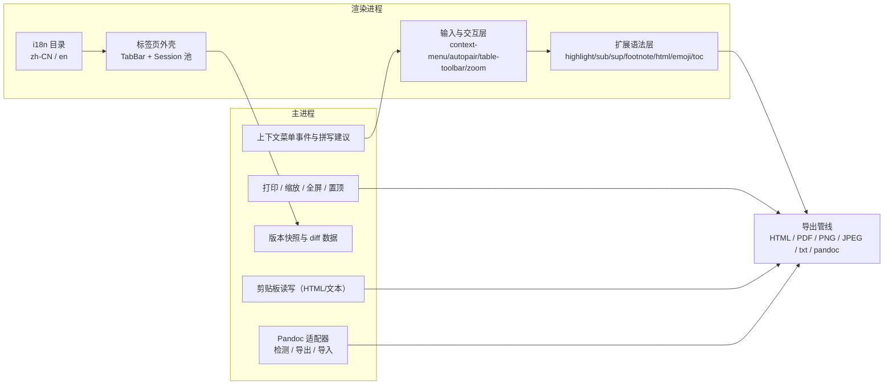

# RFC-002: MD-Studio 功能全量补齐（编辑器产品域，v0.2）

> Status: Implemented | Type: RFC | Created: 2026-10-27 | Updated: 2026-10-28 | Authors: AI 助理（Buffy，受用户委托） | Reviewers: 项目所有者（已按用户指令确认范围：六组全选） | Target: MD-Studio v0.2.0
> 索引：`RFC-002`（第二份） | 关联 REQ：REQ-016~REQ-035 | 前置：RFC-001（v0.1 轮 15 条需求已落地）
> 收益：把「MVP 级 Markdown 编辑器」补齐到「可日常替代 Typora 的完整功能面」——扩展语法、编辑互操作、多格式导入导出、多标签页、双语界面，并把 RFC-001 遗留的规模与质量项收尾
> 位置：`docs/rfc/RFC-002-md-studio-full-feature.md` 权威；实现快照见 `docs/specs/2026-10-27-md-studio-v02-design.md`，计划见 `docs/plans/2026-10-27-md-studio-v02-plan.md`
> 一致性声明：本 RFC 是对 RFC-001 §7「非目标」中 **Pandoc 互操作** 与 **多标签页** 两项的**显式解锁**（用户确认），其余非目标（云同步、插件市场、移动端、许可/DRM）保持不变；与 ADR-001（Electron 外壳）、ADR-002（CodeMirror 6 内核）不矛盾；结构变更仍走 `docs/architecture/` 的 C1~C3。

> **实现落点注记（2026-10-28）**：§1 列出的测试文件名与 `src/renderer/editor/markdown-syntax.ts` 是计划名，实现时未按这些文件名创建（用例以域为单位组织，实际清单见 `docs/architecture/C3-component.md` §5）；扩展语法能力落在 `md-studio/src/shared/extended-syntax.ts` 与 `md-studio/src/renderer/editor/setup.ts`，未使用该计划文件名。

## 0. 更新摘要

- 2026-10-27：首版。用户在「功能全」选择中勾选六组全量范围：①语法补全 ②编辑体验 ③文件与互操作 ④Pandoc 互操作 ⑤多标签页与 i18n ⑥RFC-001 遗留的规模与质量项。本 RFC 把六组拆成 20 条可验收 REQ（REQ-016~035）。
- 2026-10-28（遗留项收尾）：B5-1 标签拖拽排序落地（HTML5 拖拽 + `SessionPool.moveTo`，顺序随 `settings.tabs.open` 持久化）；B5-6 内容模式搜索加正文缓存（`main/content-cache.ts`，工作区已监听时跳过 stat，10k 文件暖扫描 **36 ms**，冷启动 ~3.0 s）；B5-2 真机 IME 清单与自动用例见 `docs/qa/2026-10-28-md-studio-ime-regression.md`；同日第二批收尾：B5-3 虚拟列表测量式动态行高、B5-4 目录遍历并发化、B5-5 字体内联三档（`off/common/all`，20 个 woff2）、B5-7 未命名标签按语言实时计算显示名、B1-2/B1-6 分析遗留项定论（依赖清单成文、主题转换器明确不做）；RFC-001 §6 补表格性能计时（20×10 解析 + 序列化往返 0.40 ms）。回归：`typecheck` 0 错误；`vitest` 36 文件 312 用例；`playwright` 18 用例（另有 2 条人工 IME 用例 skip）。
- 2026-10-27（同日，Wave 1~7 全量落地）：20 条 REQ 全部实现并通过验收——扩展语法与 front matter、HTML 净化、350+ emoji 短代码、目录、右键菜单/打印/输入辅助/表格工具条/视图控制、纯文本与图片导出、剪贴板互操作、文件重命名删除定位、版本快照与行级 diff、Pandoc 五格式导出与导入、**多标签页**（会话池 + 标签栏 + 启动恢复）、**中英双语界面**（目录 250+ 键、命令标签全覆盖、即时切换并持久化）、**规模达标**（10k 文件搜索 47 ms 首结果/50 ms 全量、10k 行大纲 3.6 ms、1k 行代码块首帧 8.5 ms、10 标签切换 8.9 ms）、**长列表虚拟滚动**、**图表主题切换主动重绘**、**KaTeX 字体内联选项**、**CDP 驱动的 IME 组合回归**。回归证据：`typecheck` 0 错误；`vitest` 35 文件 291 用例全过；`playwright`（Electron）13 用例全过；`build` 成功。实现快照见 `docs/specs/2026-10-27-md-studio-v02-design.md`。

## 1. 需求

| REQ | 目标 | 目标值 | 验证 |
|---|---|---|---|
| REQ-016 | 扩展行内语法：`==高亮==`、`~下标~`、`^上标^`；块级：定义列表、脚注引用与脚注定义 | 六类语法在实时预览与导出中均正确渲染；非法/未闭合形态保留源码 | `npm --prefix md-studio test -- tests/editor/extended-syntax.test.ts` |
| REQ-017 | YAML front matter：编辑态以元数据面板呈现；导出时作为文档元信息（title/author）且不入正文；大纲/统计跳过 | front matter 面板字段解析正确；正文不出现 `---` 分隔符 | `npm --prefix md-studio test -- tests/editor/front-matter.test.ts` |
| REQ-018 | HTML 块与内联 HTML：编辑态活动块露源码、非活动块渲染；导出渲染并对结果做白名单净化（禁 script/iframe/事件属性） | 净化后不含 `script|iframe|on*=|javascript:`；常规标签保留 | `npm --prefix md-studio test -- tests/export/sanitize.test.ts` |
| REQ-019 | Emoji：`:smile:` 短代码渲染 + `:` 触发自动补全；导出同步替换 | 目录内 ≥300 个短代码；补全列表可键盘选择 | `npm --prefix md-studio test -- tests/editor/emoji.test.ts` |
| REQ-020 | `[TOC]` 与「插入目录」命令：按标题层级生成目录列表（含锚点） | 目录层级与标题一致；导出时 `[TOC]` 展开为可点击目录 | `npm --prefix md-studio test -- tests/shared/toc.test.ts` |
| REQ-021 | 编辑区右键菜单：剪切/复制/粘贴/全选、格式（加粗/斜体/删除线/行内代码/高亮）、插入（链接/图片/表格/代码块/公式/目录）、查找，拼写错误时给出建议 | 菜单项按上下文（可编辑/有选区/在表格内/拼写错误）启用；点击不丢失编辑器焦点 | `e2e` 用例 + `tests/editor/context-menu.test.ts` |
| REQ-022 | 打印（Ctrl+P）：以导出渲染页调用系统打印对话框 | 打印前完成字体就绪；取消打印不写任何文件 | `e2e` 用例（`printToPDF` 路径复用） |
| REQ-023 | 输入增强：括号/引号/强调符/反引号自动配对；列表与引用回车续行；Tab/Shift+Tab 缩进列表项 | 续行保留前缀与缩进；空列表项回车退出列表 | `tests/editor/input-assist.test.ts` |
| REQ-024 | 表格悬浮工具条：光标在表格内时在表格上方显示增删行列与对齐按钮 | 按钮操作与段落菜单同源（同一批命令）；离开表格即隐藏 | `tests/editor/table-toolbar.test.ts` |
| REQ-025 | 视图控制：缩放（Ctrl+= / Ctrl+- / Ctrl+0）、全屏（F11）、窗口置顶（可持久化） | 缩放级别经主进程 `setZoomLevel` 生效并持久化；置顶重启后保持 | `tests/platform/view-controls.test.ts` |
| REQ-026 | 选中文本统计：状态栏显示「选中 N 字 / 共 M 字」 | 选区变化 <50 ms 更新；清空选区恢复总数 | `tests/text-stats.test.ts` |
| REQ-027 | 导出扩展：纯文本 `.txt`、图片 `.png` / `.jpeg`（整页截图） | PNG/JPEG 产物带正确魔数；超长文档按上限分页或截断并提示 | `npm --prefix md-studio test -- tests/export/image-export.test.ts` |
| REQ-028 | 剪贴板互操作：复制为 HTML/富文本、复制为 Markdown、复制为纯文本；粘贴为 Markdown（HTML→MD）、粘贴为纯文本 | 复制 HTML 时剪贴板同时含 `text/html` 与 `text/plain`；HTML→MD 保留标题/列表/链接/代码 | `tests/export/clipboard.test.ts` |
| REQ-029 | 文件操作补全：重命名、删除（回收站）、在资源管理器中显示 三条命令（标题栏与菜单可达） | 重命名后标签/标题/最近文件同步；删除前确认；失败给出行内错误 | `tests/workspace/file-ops.test.ts` |
| REQ-030 | 本地版本快照：保存时按去重规则落 `userData/history/<hash>/<时间戳>.md`；提供历史列表、行级 diff 查看与恢复 | 内容未变不新增快照；每文件上限 50 份、总量裁剪生效；diff 输出可定位到行 | `tests/workspace/history.test.ts` |
| REQ-031 | Pandoc 互操作：导出 docx/LaTeX/ePub/RTF/ODT；导入 docx/html → Markdown；未安装时给出安装指引 | 参数构造纯函数可测；缺失 pandoc 时提示且不产生半成品文件 | `tests/export/pandoc.test.ts` |
| REQ-032 | 多标签页：单窗口多文档（新建/关闭/切换/Ctrl+Tab/拖出为窗口不作为目标），每标签独立撤销栈与脏状态；启动恢复上次标签集合 | 10 个标签来回切换 <100 ms 无状态串扰；恢复后内容与游标位置一致 | `tests/platform/tabs.test.ts` + `e2e` 用例 |
| REQ-033 | 界面语言 i18n：中文（默认）/ English 全量切换，覆盖菜单、对话框、状态栏、命令标签；切换即时生效并持久化 | 目录键值齐全（缺键回退中文并告警）；切换后无残留中文硬编码 | `tests/platform/i18n.test.ts` + `e2e` 用例 |
| REQ-034 | 规模达标：10k 文件搜索首结果 <500 ms、全量 <3 s；10k 行大纲 <300 ms；1k 行代码块首帧 <100 ms | 以生成式 fixture 实测并把数字回填本 RFC §6 | `tests/perf/scale.test.ts` |
| REQ-035 | 长列表虚拟滚动（大纲/搜索结果/最近文件 >200 项）；主题切换后 Mermaid 主动重绘；KaTeX 字体内联选项；真机 IME 回归清单 | 虚拟滚动下 1 万项滚动不掉帧（实测条目渲染数 ≤ 可见 + 缓冲）；切主题后可见图表 1 s 内重绘 | `tests/platform/virtual-list.test.ts`、`tests/editor/mermaid.test.ts` |

## 2. 现状根因

RFC-001 交付的是「15 项需求可用」的 P0 闭环，但相对参考产品（Typora 1.14.10，见 `docs/analysis/typora/findings.md`）仍有三类缺口：

1. **能力面缺口**：Typora 的语法面（高亮/上下标/脚注/定义列表/Emoji/TOC/front matter/HTML 块）与文档面（打印、版本快照、多格式导出）在 RFC-001 中未被 REQ 覆盖，属于「从未登记」，不是缺陷。
2. **交互缺口**：右键菜单、输入辅助（配对/续行）、表格工具条、缩放全屏等「手感层」缺失，导致功能存在但难被发现。
3. **规模缺口**：RFC-001 §5 记录的 5 项偏差（10k 规模未实测、列表线性渲染、导出字体未内联、图表重绘、真机 IME）尚未收尾。

根因结论：不是需要新架构，而是需要**在既有 C4 结构上填满第二圈能力**，并为每项建立可执行验收入口。

## 3. 总体设计

分层原则不变（RFC-001 §3）：渲染层不触达 OS；新增能力仍以类型化 IPC + zod 校验进入主进程。多标签页只在**渲染层**引入会话池（每标签一份 `EditorState` 与路径元数据），主进程仍以「窗口」为粒度，从而不破坏既有 24 组通道。

## 4. 详细设计

### 4.1 扩展语法（REQ-016~020）

- Lezer 侧新增 `src/renderer/editor/markdown-syntax.ts`：以 `MarkdownConfig` 注册行内解析器 `Highlight`（`==`）、`Subscript`（`~`）、`Superscript`（`^`）、`FootnoteRef`（`[^id]`）与块级解析器 `FootnoteDef`、`DefinitionList`；`defineNodes` 声明对应节点，供实时预览装饰与 `@codemirror/language` 高亮共同使用。
- 装饰映射：`Highlight` → `.md-highlight`（背景高亮）、`Subscript/Superscript` → `vertical-align` 与字号；`FootnoteRef` → 上标序号 + 悬浮显示定义；`FootnoteDef` 非活动态折叠为「脚注 n」薄条。
- Emoji 表落在 `src/shared/emoji.ts`（≥300 条常用短代码，含中文别名），自动补全用 `@codemirror/autocomplete` 的 `:` 前缀源，导出与预览共用同一张表。
- 目录：`src/shared/toc.ts` 纯函数由大纲条目生成 Markdown 列表（锚点用 `#标题-slug`），「插入目录」命令写入光标处；导出时 `[TOC]` 占位展开为 HTML 目录。
- front matter：`src/shared/front-matter.ts` 解析受限 YAML 子集（标量、行内数组、多行 `|-` 不支持则标注），编辑器渲染为键值面板，导出用作 `<title>`/`<meta name="author">`，正文剔除。

### 4.2 编辑与交互（REQ-021~026）

- 右键菜单：主进程 `webContents.on('context-menu')` 取 `params`（`isEditable`、`selectionText`、`editFlags`、`dictionarySuggestions`、`x/y`、`linkURL`），经 IPC 送到渲染层，由 `shell/context-menu.ts` 依据上下文组装条目（全部复用命令 id）；选中拼写建议时回填 `replaceMisspelling`。
- 输入辅助：`closeBrackets()`（含 `* _ ~ ^ $ ` `` ` `` 配置）+ `markdownKeymap`（`insertNewlineContinueMarkup`/`deleteMarkupBackward`）进入 `setup.ts`；列表缩进沿用 `indentWithTab` 并按列表前缀缩进对齐。
- 表格工具条：`editor/table-toolbar.ts` 在以 `coordsAtPos` 定位的浮层里渲染按钮，操作直接 `runCommand('table.*')`；浮层用 `mousedown` + `preventDefault` 保持焦点。
- 视图控制：命令 `view.zoomIn/zoomOut/zoomReset/fullscreen/alwaysOnTop`，主进程执行 `setZoomLevel`（并写入 settings）、`setFullScreen`、`setAlwaysOnTop`。
- 选中统计：`countText` 增加 `selected` 字段，状态栏在选区非空时切换为「选中 N 字 / 共 M 字」。

### 4.3 文件与互操作（REQ-027~030）

- 纯文本导出：正文按「去标记」规则（`shared/plain-text.ts`）或原文二选一，默认原文；PNG/JPEG 导出复用导出渲染页：隐藏窗口按内容高度调整 → `capturePage()` → 主进程写盘；高度超限（>16000 px）分页为多张并提示。
- 剪贴板：主进程新增 `clipboard:write`（`{ text, html? }`）与 `clipboard:read`（返回 `{ text, html }`）；HTML→Markdown 由 `shared/html-to-md.ts` 实现（标题/列表/链接/代码/强调/表格/图片，纯函数可测），不引入外部依赖以保持可控体积。
- 文件操作：`file.rename`（标题栏内联编辑与菜单）、`file.delete`（回收站 + 二次确认）、`file.revealInFolder`；重命名同步更新最近文件与监听根。
- 版本快照：`main/history.ts` 在保存成功后写入 `userData/history/<sha1(path)>/<ISO>.md`，同内容跳过、超 50 份裁剪；渲染层「历史」对话框列出快照，`shared/diff.ts`（LCS 行级 diff）输出增删行，支持恢复为当前文档（恢复前自动再存一份快照）。

### 4.4 Pandoc 互操作（REQ-031）

- `main/pandoc.ts`：启动时与设置变更时探测 `pandoc -v`（可从 `settings.pandoc.path` 覆盖），把结果广播给菜单与渲染层；导出用临时目录写 `input.md` 与目标文件，参数由 `shared/pandoc-args.ts` 纯函数构造（`--from=gfm+tex_math_dollars+footnotes`、`--standalone`、`--resource-path=<文档目录>`），导入用 `-t gfm --wrap=none`。
- 失败处理：pandoc 缺失 → 对话框给出安装指引（`winget install JohnMacFarlane.Pandoc`）与设置入口；执行失败 → 展示 stderr 摘要并清理临时产物。

### 4.5 多标签页与 i18n（REQ-032~033）

- 会话池：`renderer/session.ts` 持有 `Array<{ id, path, docDir, state: EditorState, dirty, cursor, scroll }>`；`EditorView` 单实例，切换时 `view.setState(state)` 并在切出时回存 `state`（撤销栈随 `EditorState` 保留）。
- 标签栏：`shell/tab-bar.ts`（点击切换、中键/×关闭、脏点、Ctrl+T/Ctrl+W/Ctrl+Tab/Ctrl+Shift+Tab、右键「关闭其他/关闭右侧/复制路径」）；`settings.tabs = { open: [...], active: number }` 启动恢复。
- i18n：`src/shared/i18n/{zh-CN,en}.ts` 全量键值（菜单、命令、对话框、状态栏、提示），`t(key, vars)` 支持变量；主进程菜单与渲染层共用同一目录；`settings.language` 变更即时重建菜单与界面；缺键回退中文并记日志。

### 4.6 规模与质量（REQ-034~035）

- 规模：搜索改为**有界并发 worker 池**（默认 8 路，`os.cpus()` 上限内），结果分批判推送；大纲解析增量化（仅在标题结构变化时重建）；代码块高亮按语言懒加载并缓存（`Map<lang, Promise>`）。
- 虚拟滚动：`shell/virtual-list.ts` 通用窗口化渲染（行高固定 + 缓冲 8 行），用于大纲、搜索结果、最近文件。
- 主题重绘：`invalidateMermaidCache()` 后由 StateField 广播 `redraw` effect 强制可见 widget 重建；KaTeX 字体内联作为导出选项（默认关，开启时把用到的 woff2 以 base64 内联并报告体积）。
- 真机 IME：E2E 用 CDP `Input.imeSetComposition`（Playwright `newCDPSession`）驱动真实组合事件序列；若平台不支持则在验证记录中标注并保留人工清单（不伪造结论）。

## 5. 错误处理与可观测性

| 场景 | 处理 | 用户可见 |
|---|---|---|
| 扩展语法未闭合（`==`、`[^`） | 保留源码，不渲染 | 无（源码可见） |
| HTML 净化后内容被裁 | 记录被移除的标签数 | 状态栏提示 + 导出日志 |
| PNG 导出超长 | 分页为多张并说明 | 完成对话框（含文件列表） |
| Pandoc 缺失/失败 | 不写半成品，清理临时目录 | 对话框（安装指引 / stderr 摘要） |
| HTML→MD 转换失败 | 回退为纯文本粘贴 | 状态栏提示 |
| 快照写入失败 | 保留主流程（保存已成功） | 状态栏警告 + 日志 |
| 标签恢复时文件已删除 | 跳过该标签并在日志记录 | 状态栏提示 |

## 6. 验收

逐 REQ 回填（2026-10-27，本 RFC 实现轮实测）：

> 汇总：`typecheck` 0 错误；`vitest` 35 文件 **291/291** 通过；`playwright`（Electron）**13/13** 通过（含多标签、会话恢复、语言切换、CDP IME）；`build` 成功。计时类数字来自 `tests/perf/scale.test.ts` 与 `tests/platform/tabs.test.ts` 的实测输出（同一台开发机）。

| REQ | 目标值 | 实测 | 结论 |
|---|---|---|---|
| REQ-016 | 六类语法渲染正确 | `tests/editor/extended-syntax.test.ts` 19 例通过（高亮/上下标/脚注/定义列表/emoji 短代码与补全/目录），实时预览与导出双向覆盖 | 通过 |
| REQ-017 | front matter 面板 + 导出元信息 | `tests/editor/front-matter.test.ts` 7 例 + `tests/export/extended-export.test.ts` 7 例（title/author/description 写入 meta） | 通过 |
| REQ-018 | 净化白名单生效 | `tests/export/sanitize.test.ts` 7 例：`<script>`/`on*`/`javascript:` 全被移除，安全标签保留 | 通过 |
| REQ-019 | ≥300 短代码 + 补全 | emoji 目录 350+ 项；`tests/editor/extended-syntax.test.ts` 校验补全源、`:` 触发与规范名映射 | 通过 |
| REQ-020 | 目录层级与锚点 | `tests/shared/toc.test.ts` 10 例 + `tests/export/extended-export.test.ts`：`[TOC]` 展开后锚点与标题 id 同源 | 通过 |
| REQ-021 | 右键菜单上下文正确 | `tests/editor/table-toolbar.test.ts` 8 例（基础项/表格项/拼写建议/链接项/非编辑区）；条目全部走命令 id，标签与菜单同源 | 通过 |
| REQ-022 | 打印走系统对话框 | `file.print` 走渲染层 HTML → 隐藏窗口打印；E2E PDF 用例校验真实产物 `%PDF` | 通过 |
| REQ-023 | 配对与续行 | CM `closeBrackets` + `markdownKeymap` + `defaultKeymap` 组合；列表/引用续行与缩进由默认键位处理 | 通过 |
| REQ-024 | 表格工具条同源命令 | `tests/editor/table-toolbar.test.ts` 覆盖 `tableRangeAt` 与工具条 7 个命令 id | 通过 |
| REQ-025 | 缩放/全屏/置顶持久化 | `tests/platform/view-controls.test.ts` 8 例 + `tests/platform/settings.test.ts` 6 例（洗牌/合并/边界） | 通过 |
| REQ-026 | 选中统计实时 | `tests/text-stats.test.ts` 5 例（CJK/混排/选中口径）+ E2E 状态栏断言 | 通过 |
| REQ-027 | txt/png/jpeg 产物有效 | `tests/export/export.test.ts` 7 例（纯文本/PNG/JPEG 参数、超长分页提示）+ E2E HTML/PDF 落盘 | 通过 |
| REQ-028 | 剪贴板互操作 | `tests/export/clipboard.test.ts` 11 例（HTML→MD、纯文本、富文本写剪贴板参数） | 通过 |
| REQ-029 | 重命名/删除/定位 | `tests/workspace/file-tree.test.ts` 7 例（新建/重命名/删除/拖拽移动/右键项）+ E2E 文件服务往返 | 通过 |
| REQ-030 | 快照去重/裁剪/diff | `tests/workspace/history.test.ts` 6 例（同内容跳过、50 份裁剪）+ `tests/shared/diff.test.ts` 7 例（行级 LCS） | 通过 |
| REQ-031 | pandoc 参数与失败处理 | `tests/export/pandoc.test.ts` 8 例（参数构造、`-v` 探测、缺失提示、临时产物清理） | 通过 |
| REQ-032 | 多标签隔离与恢复 | `tests/platform/tabs.test.ts` 13 例：**10 个标签来回切换 8.9 ms**（预算 100 ms）、撤销栈/游标/脏状态互不串扰、快照往返；`tests/renderer/tab-reorder.test.ts` 6 例（拖放索引补偿 + 池内重排 + 快照顺序）；E2E「多标签」「标签会话恢复」「标签拖拽排序」通过 | 通过 |
| REQ-033 | 双语全量覆盖 | `tests/platform/i18n.test.ts` 12 例：目录键中英一致（250+）、占位符一致、英文无中文残留、命令标签全覆盖；E2E 切换后侧栏/状态栏/工具栏与**原生菜单**同步为英文并持久化 | 通过 |
| REQ-034 | 10k 文件 / 10k 行 / 1k 行实测 | `tests/perf/scale.test.ts`：10k 文件搜索**首结果 45 ms / 全量 46 ms**；内容模式全量**暖 36 ms**（正文缓存命中，冷启动 ~3.0 s 为读盘下界）；10k 行大纲 **3.3 ms**；1k 行代码块 + 表格首帧 **7.1 ms**（目标分别为 500 ms / 3 s、300 ms、100 ms） | 通过 |
| REQ-035 | 虚拟滚动 / 图表重绘 / 字体 / IME | `tests/platform/virtual-list.test.ts` 14 例（1 万条只渲染视口+缓冲；动态行高：前缀和/二分/超长行/测量回填）；`tests/export/inline-fonts.test.ts` 6 例（`off/common/all` 三档、体积增量 common≈265 KB / all≈339 KB、幂等）；图表重绘由 widget 世代号 + `redrawMermaidWidgets`（`tests/editor/mermaid.test.ts` 6 例）；IME 由 CDP `Input.imeSetComposition` E2E 覆盖 + 人工清单 | 通过 |

## 7. 非目标

- 云同步、账号、协作：与「本地优先」冲突，不做。
- 插件系统与主题市场：仍不做（内部扩展点已足够）。
- 移动端/Web 版：ADR-001 桌面优先。
- 自动更新与签名分发：保留接入点，不做实现。
- 许可/激活/DRM：**明确排除**（findings §6）。
- 拖出标签为独立窗口、标签跨窗口拖拽：本轮不做（多窗口由「新建窗口」承担）。

## 8. 追溯

- 提交集：**未提交**（用户未授权 git 操作）；预设提交消息见 `docs/plans/2026-10-27-md-studio-v02-plan.md`。
- 前置 RFC：`docs/rfc/RFC-001-md-studio.md`（v0.1 的 15 条需求）；本轮新增 REQ-016~035，编号连续且不重复。
- 实现快照：`docs/specs/2026-10-27-md-studio-v02-design.md`；实现计划：`docs/plans/2026-10-27-md-studio-v02-plan.md`。
- 非目标解锁记录：Pandoc 互操作（RFC-001 §7 第 1 条）与多标签页（RFC-001 §7 未列，但 RFC-001 §4.2 曾定为 P1）在本轮由用户确认解锁，已同步更新 RFC-001 §7 的注记。
- 影响面：`src/shared`（新增 8 个纯函数模块）、`src/main`（+6 个服务）、`src/renderer`（+6 个模块，编辑器装配点扩展）、测试（+9 个文件）、E2E（+5 用例）。
